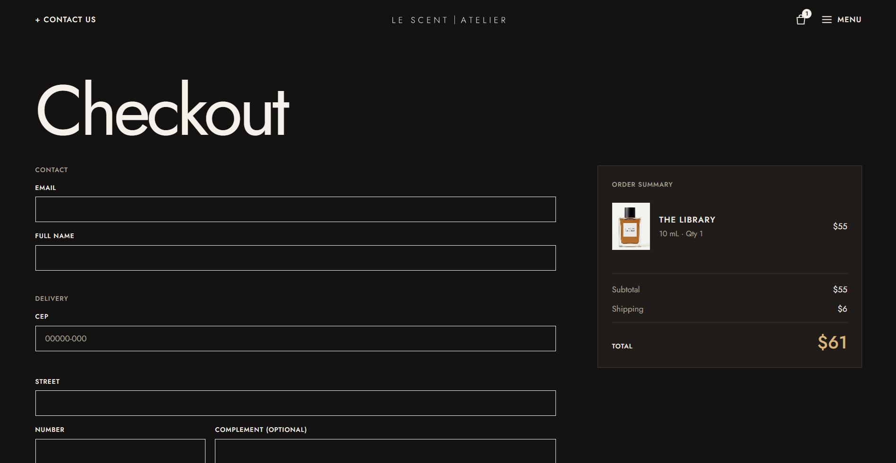

# Le Scent Atelier

> Scent. Elevating Everyday

**[Live demo](https://danielgranato.github.io/le-scent-atelier/)** · Fictional niche-perfume storefront · React + TypeScript + Tailwind

## Screenshots

**Home**: the spray hero, the perfume carousel and the scent families.


**About**: its own design, with a full-screen black-and-white hero.


**Checkout**: the fictional checkout in its "cinematic dark" theme.



A front-end portfolio project: an online store for a made-up perfume brand, built to practice clean architecture, forms, accessibility and visual design. There is no real back end; products come from local mock data behind a small service layer, so a real API can be plugged in later.

> **Portfolio project. Fictional brand, no real products are sold.** Not affiliated with any real brand. Nothing is shipped and no payment is processed.

## Highlights

- **Spray hero**: words (scent notes) fly out of a bottle's nozzle, drawn on a `<canvas>` with no animation library. Click the bottle to spray. It pauses off-screen and respects `prefers-reduced-motion`.
- **15 fictional perfumes** in four scent families (fresh, floral, woody, amber), each with notes, a short story and three sizes. Catalog with family filter, search and sorting (state lives in the URL).
- **Size selector** on the product page: price and stock change per size (10 / 50 / 100 mL); out-of-stock sizes are disabled.
- **Cart** (drawer + `/cart` page) persisted in `localStorage`, with prices always re-read from the product data.
- **Fictional checkout** with a "cinematic dark" theme, automatic address fill from the CEP (ViaCEP API), loading states that lock the form, and a demo order confirmation. No card fields on purpose.
- **Mock auth**: login and register with React Hook Form + Zod. Passwords are never stored as plain text (SHA-256 hash, mock only, not real security).
- **Contact panel**: a side drawer with a validated form, available from the header.
- **About page with its own design**: full-screen black-and-white split hero and a transparent header, a deliberate exception to the design system.
- **A written design system** (`DESIGN.md`): square corners, thin lines, tight typography, a small palette. Mobile-first and responsive.

## Status

- [x] Design tokens and typography
- [x] Home with spray banner
- [x] Catalog with family filter, search and sorting
- [x] Product page with size selector
- [x] Cart (drawer and page)
- [x] Login and sign-up (mock)
- [x] Contact (drawer and page)
- [x] About, Shipping, Legal, Notes and Special editions pages
- [x] Fictional checkout with CEP autofill
- [x] Deploy to GitHub Pages

## Tech stack

| Area | Choice |
|---|---|
| Build tool | Vite |
| UI | React 19 + TypeScript (strict) |
| Styling | Tailwind CSS v4 (design tokens in `src/styles/index.css`) |
| Routing | React Router (`HashRouter`, so GitHub Pages works on reload) |
| Forms | React Hook Form + Zod (with `@hookform/resolvers`) |
| State | Context API (`AuthProvider`, `CartProvider`) |
| Data | Local JSON mocks behind `services/http.ts` |
| External API | ViaCEP (public, no key) for the checkout address lookup |
| Lint | oxlint |
| Font | Jost (Google Fonts) |
| Deploy | GitHub Actions to GitHub Pages |

## Getting started

You need Node.js 20 or newer.

```bash
git clone https://github.com/DanielGranato/le-scent-atelier.git
cd le-scent-atelier
npm install
npm run dev
```

| Script | What it does |
|---|---|
| `npm run dev` | Starts the local dev server |
| `npm run build` | Type-checks and builds for production |
| `npm run preview` | Serves the production build locally |
| `npm run lint` | Runs oxlint |

## Project structure

```
public/images/        product photos, families, favicons
src/
  app/          App, router, providers
  pages/        one thin file per route (Home, Catalog, ProductDetail, Cart,
                Checkout, OrderConfirmation, Login, Register, Contact, About...)
  features/     auth, cart, checkout, contact, products, about, shipping,
                legal, newsletter, special-edition (each one self-contained)
  components/   ui/ (Button, Input, Select, Drawer...), layout/ (Header, Footer...),
                SprayBanner/
  mocks/        products.json
  services/     http.ts (data access layer)
  hooks/        useDebounce, useLocalStorage, useDocumentMeta
  lib/          formatPrice, cn
  styles/       index.css (Tailwind + tokens)
```

Pages only compose; logic lives in `features/` and hooks. New features (favorites, reviews) are added as a new folder.

## Decisions worth mentioning

- **Feature folders** instead of grouping by file type, so each domain can grow without touching the rest.
- **Service layer for data**: components never read the JSON directly. Replacing the mocks with a real API only changes `services/` and `features/products/api.ts`.
- **`HashRouter`** because GitHub Pages cannot rewrite SPA routes. The Vite `base` is set to the repo name.
- **Zod for forms and for storage**: besides validating every form, Zod checks the cart data read back from `localStorage`, so bad stored data never crashes the app.
- **Cart prices are never trusted from storage**: only product id, size and quantity are stored; prices are read again from the product data.
- **CEP lookup without races**: the request is aborted when the CEP changes and stale answers are ignored; network errors fall back to manual entry.
- **Spray animation split in two**: `sprayEngine.ts` (plain TypeScript, canvas) and `SprayBanner.tsx` (React wrapper), so the animation logic is independent from React.
- **Declared design exceptions**: the About hero and the checkout theme break the light design system on purpose, and are documented in `DESIGN.md`.
- **No card form in a fictional store**: the checkout only offers simulated payment methods, so nobody is tempted to type a real card number.
- **Accessibility**: decorative canvas words are `aria-hidden`, forms have linked labels and errors (`aria-describedby`, `aria-invalid`), drawers trap focus and close with Esc, motion respects `prefers-reduced-motion`.

## Deployment

The site is published to GitHub Pages by a GitHub Actions workflow on every push to `main`. In the repository settings go to **Pages** and choose **GitHub Actions** as the source. Make sure `base` in `vite.config.ts` matches the repository name (`/le-scent-atelier/`).

## Credits and notes

- All photos (products, hero, About) were generated with AI tools. The brand, products and texts are invented.
- Logo drawn as SVG from the Jost typeface (open font, SIL OFL).
- Address lookup by [ViaCEP](https://viacep.com.br/) (public API).
- Visual direction inspired by the general principles of independent perfume sites (typography-led, square, product-first). No text, images, logos or fonts were copied from any brand.

## Author

Made by **Daniel Granato** · [GitHub](https://github.com/DanielGranato)
